# Entregable 3 · Diseño de Sistemas de Información · Literalia

> Borrador del documento a exportar en PDF. Todo el contenido técnico (arquitectura, patrones, SOLID y diagramas) se derivó del código de este repositorio. Las partes marcadas con **[COMPLETAR]** dependen de los Entregables 1 y 2 o de datos del equipo que no están en el repositorio.

**Archivos de esta carpeta**

| Recurso | Ruta |
|---|---|
| Todos los diagramas, editables, en un solo archivo draw.io (15 páginas ordenadas) | [`literalia-entregable3.drawio`](literalia-entregable3.drawio) · [abrir en draw.io][drawio] |
| Código Mermaid de cada diagrama | [`mermaid/`](mermaid/) |
| Imágenes PNG de cada diagrama (para el PDF) | [`img/`](img/) |
| Capturas del prototipo funcional | [`capturas/`](capturas/) |

---

## 0. Portada

- **Nombre del proyecto:** Literalia — Sistema de gestión para librería
- **Integrantes:** [COMPLETAR nombres completos] (en el historial del repositorio aparecen: Stiven Atehortúa Ochoa, Brayan, dahianamon12)
- **Docente:** [COMPLETAR]
- **Curso:** Diseño de Sistemas de Información
- **Fecha:** [COMPLETAR]
- **Institución:** Instituto Tecnológico Metropolitano (ITM), Medellín

---

## 1. Refinamiento y consolidación del Entregable 2

[COMPLETAR: resumir en 3-5 viñetas la retroalimentación recibida en el Entregable 2 y qué se cambió por cada punto.]

Lo que el código evidencia sobre la evolución del proyecto:

| Insumo de entregas anteriores | Cómo se mantiene / refina en el Entregable 3 |
|---|---|
| **Requisitos y reglas de negocio** | Se convirtieron en validaciones concretas: ISBN único (`main.py`), correo de cliente único (409), stock nunca negativo (`InventarioRepository.modificar_stock`, UPDATE condicionado), descuento entre 0 % y 100 % (`VentaCreate.porcentaje_descuento`), venta atómica con ROLLBACK, roles admin/vendedor validados en el backend (`requiere_roles`). |
| **Actores / roles** | Administrador y Vendedor quedaron como el campo `UsuarioModel.rol` y como guardas en front (`SoloAdmin`) y back (`requiere_roles`). |
| **Story mapping y MVP** | La primera versión entregable cubre las épicas Autenticación, Catálogo/Inventario, Clientes y Ventas (HU-01 a HU-05). Dashboard, Proveedores, recuperación de contraseña y gestión completa de usuarios quedan para siguientes versiones (aparecen deshabilitados o marcados como TODO en el código). |
| **Diagrama de clases inicial** | Se refinó en el nivel 4 del C4: el dominio quedó en 6 entidades ORM (`Libro`, `Usuario`, `Cliente`, `Venta`, `DetalleVenta`, `MovimientoInventario`) y se agregaron clases de diseño (repositorios, Strategy, Factory). |
| **Prototipo Figma** | Las pantallas implementadas (Login, Inventario, Ventas, Clientes, Usuarios) conservan la navegación lateral, las tarjetas de resumen y los modales del prototipo. [COMPLETAR: enlace a Figma y 1-2 diferencias entre Figma y la implementación.] |

### Historias de usuario del MVP implementadas

| ID | Historia de usuario | Rol | Pantalla · Endpoint |
|---|---|---|---|
| HU-01 | Como usuario quiero iniciar sesión con mi correo y contraseña para acceder a las funciones de mi rol. | Admin, Vendedor | Login · `POST /auth/login` |
| HU-02 | Como administrador quiero registrar un libro con ISBN, precio y stock mínimo para tenerlo en el inventario. | Admin | Inventario · `POST /libros` |
| HU-03 | Como administrador quiero registrar entradas y salidas de stock con un motivo para mantener el inventario real y trazable. | Admin | Inventario · `POST /inventario/movimientos` |
| HU-04 | Como vendedor quiero registrar los datos de un cliente para asociarle sus compras. | Vendedor, Admin | Clientes · `POST /clientes` |
| HU-05 | Como vendedor quiero registrar una venta de varios libros con descuento opcional para que el stock se descuente automáticamente. | Vendedor, Admin | Ventas · `POST /ventas` |

> Ajusten los IDs (HU-01…HU-05) para que coincidan con la numeración de su story mapping del Entregable 1.

---

## 2. Arquitectura C4

Todos los niveles están en el archivo draw.io (páginas 01 a 04) y también en Mermaid.

### Nivel 1 · Contexto

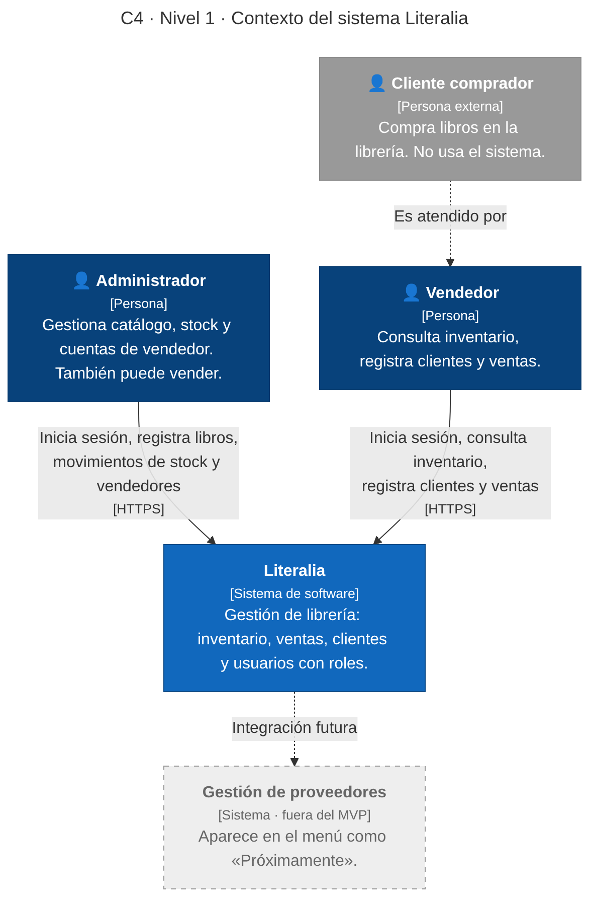

Enlaces editables: [draw.io, página «01 · C4 Contexto»][drawio] · [Mermaid Live][m01]

Literalia es usado por dos personas: el **Administrador**, que gestiona catálogo, stock y cuentas de vendedor, y el **Vendedor**, que consulta inventario, registra clientes y ventas. El cliente comprador no usa el sistema: lo atiende el vendedor. La gestión de proveedores aparece punteada porque quedó fuera del MVP.

### Nivel 2 · Contenedores

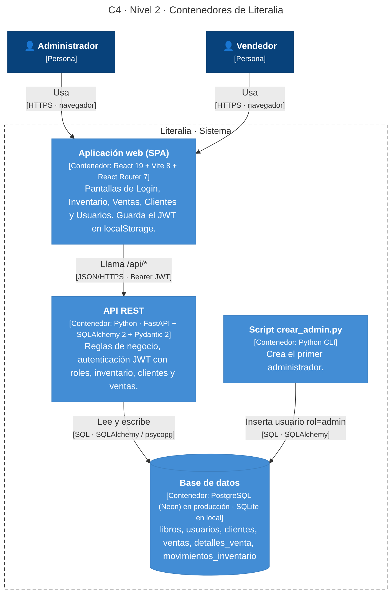

Enlaces editables: [draw.io, página «02 · C4 Contenedores»][drawio] · [Mermaid Live][m02]

El sistema tiene una **SPA en React 19 + Vite**, una **API REST en FastAPI** (SQLAlchemy + Pydantic + JWT) y una **base de datos relacional**: PostgreSQL en Neon en producción y SQLite en local (`database.py` decide según `DATABASE_URL`). El script `crear_admin.py` crea el primer administrador. La SPA solo habla con la API por `/api/*` con un token Bearer.

### Nivel 3 · Componentes (API REST)

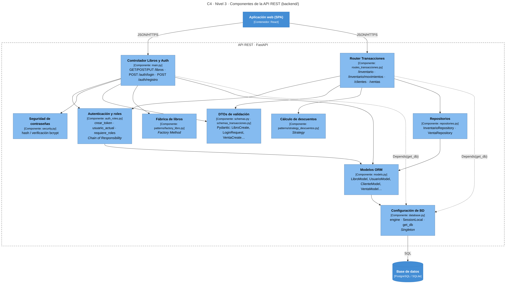

Enlaces editables: [draw.io, página «03 · C4 Componentes»][drawio] · [Mermaid Live][m03]

La API se divide en dos controladores (`main.py` para libros y autenticación; `routes_transacciones.py` para inventario, clientes y ventas), servicios transversales (autenticación y roles, hash de contraseñas, validación con Pydantic), los patrones (fábrica de libros y cálculo de descuentos) y la capa de datos (repositorios, modelos ORM y configuración de BD). Cada componente indica qué patrón GoF implementa.

### Nivel 4 · Código / Clases

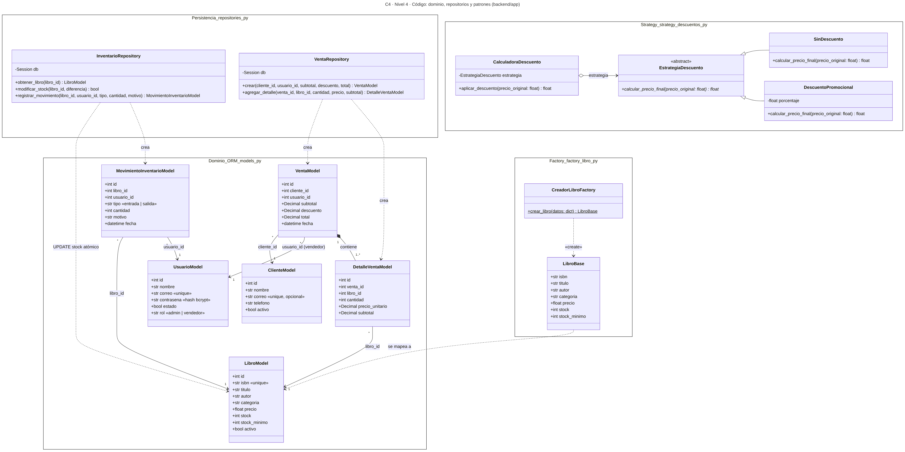

Enlaces editables: [draw.io, página «04 · C4 Código-Clases»][drawio] · [Mermaid Live][m04]

Es el refinamiento del diagrama de clases del Entregable 1. **Venta** se compone de uno o más **DetalleVenta**; cada detalle y cada **MovimientoInventario** apuntan a un **Libro**; la venta guarda el **Cliente** y el **Usuario** vendedor. Los repositorios encapsulan la persistencia, y los paquetes `strategy_descuentos` y `factory_libro` muestran las clases de los patrones.

---

## 3. Patrones de diseño

Se seleccionaron **cinco patrones GoF distintos**, uno por necesidad real del MVP. Página «05 · Patrones GoF» del draw.io.

| # | Patrón | Tipo | Necesidad del MVP | Dónde | HU |
|---|---|---|---|---|---|
| 1 | Strategy | Comportamiento | Calcular el total con o sin descuento sin llenar el endpoint de condicionales | `backend/app/patterns/strategy_descuentos.py`, usado en `routes_transacciones.py:274-283` | HU-05 |
| 2 | Factory Method | Creacional | Centralizar la creación de libros y sus valores por defecto | `backend/app/patterns/factory_libro.py`, usado en `main.py:105` | HU-02 |
| 3 | Singleton | Creacional | Un único motor y pool de conexiones a la BD por proceso | `backend/app/database.py:16-21` (también `security.py:3`) | Todas |
| 4 | Chain of Responsibility | Comportamiento | Validar token, usuario activo y rol antes de cada endpoint | `backend/app/auth_roles.py:17-89` (`bearer → usuario_actual → requiere_roles`) | HU-01 y protegidas |
| 5 | Facade | Estructural | Que las pantallas consuman la API sin conocer URLs, token ni formatos de error | `frontend/src/api.js` | Todas (frontend) |

**Repository** (`repositories.py`) también se usa, pero es un patrón de Fowler (PoEAA), no GoF, así que no se cuenta dentro de los cinco.

| Strategy | Factory Method |
|---|---|
| 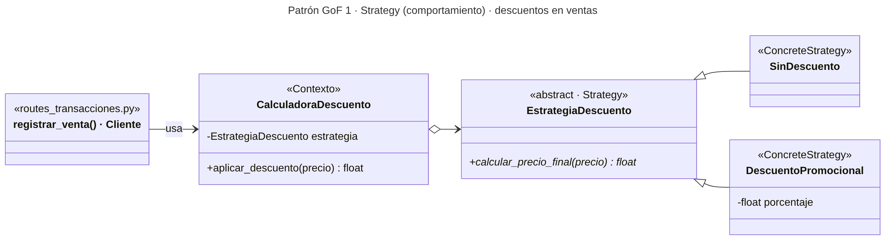 [Mermaid][m05a] | 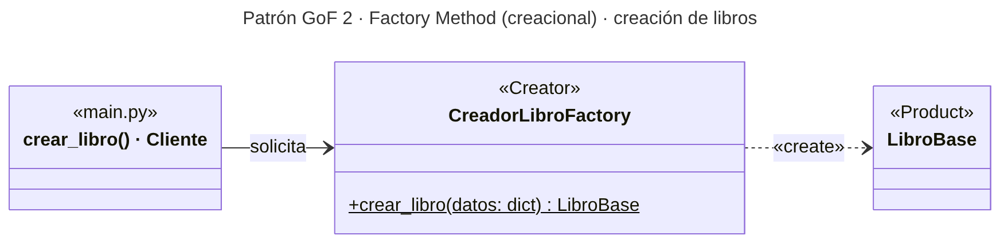 [Mermaid][m05b] |
| **Singleton** | **Chain of Responsibility** |
| 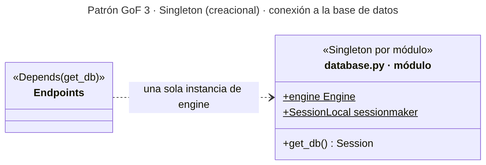 [Mermaid][m05c] | 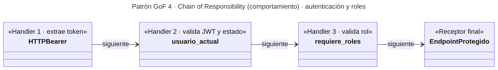 [Mermaid][m05d] |
| **Facade** | |
| 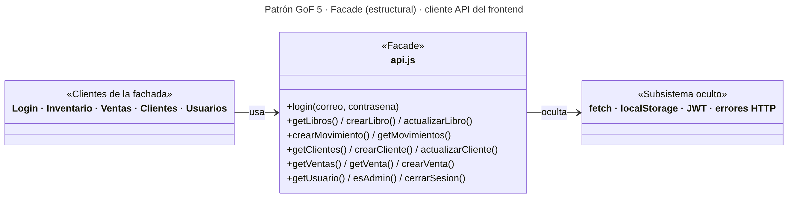 [Mermaid][m05e] | |

### Plantilla de análisis y selección de patrones GoF (diligenciada)

> Si el docente entregó un formato oficial, copien estas filas en sus campos.

#### Patrón 1 · Strategy

| Campo | Contenido |
|---|---|
| Categoría | Comportamiento |
| Problema / necesidad | Una venta puede tener o no descuento promocional, y a futuro otros tipos (cliente frecuente, temporada). Un `if/else` dentro del endpoint crecería con cada regla. |
| Relación con el MVP | HU-05 Registrar venta con descuento (épica Ventas, primera versión del story mapping). |
| Alternativas consideradas | (a) Condicionales en `registrar_venta`; (b) Template Method con una venta base y subclases; (c) Strategy. |
| Por qué se eligió | El descuento es un algoritmo intercambiable en tiempo de ejecución según el dato de entrada; Strategy lo aísla en clases pequeñas y probables por separado. Template Method obligaría a heredar de la venta, lo que acopla más. |
| Aplicación concreta | `EstrategiaDescuento` (ABC) con `SinDescuento` y `DescuentoPromocional(porcentaje)`; `CalculadoraDescuento` es el contexto. `registrar_venta` elige la estrategia según `porcentaje_descuento` y llama `aplicar_descuento(subtotal)`. |
| Beneficio | Agregar un descuento es crear una subclase, sin tocar la calculadora (OCP). |
| Riesgo de sobreingeniería | Bajo: 4 clases cortas. No se agregaron estrategias que el MVP no usa. |
| Estado | Implementado. |

#### Patrón 2 · Factory Method

| Campo | Contenido |
|---|---|
| Categoría | Creacional |
| Problema / necesidad | Crear un libro implica aplicar valores por defecto (stock 0, stock mínimo 5) y mapear los datos del formulario. Repetir eso en cada endpoint o script duplica reglas. |
| Relación con el MVP | HU-02 Registrar libro (épica Catálogo). |
| Alternativas consideradas | (a) Construir `LibroModel` directamente en el endpoint; (b) Builder; (c) Factory Method. |
| Por qué se eligió | El libro tiene pocos atributos y una sola forma de construcción: Builder sería excesivo. La fábrica deja un único punto para cambiar cómo nace un libro (por ejemplo, libro físico vs. digital en el futuro). |
| Aplicación concreta | `CreadorLibroFactory.crear_libro(datos)` devuelve un `LibroBase`; `main.crear_libro` lo mapea a `LibroModel` y lo guarda. |
| Beneficio | Reglas de creación en un solo lugar; el endpoint no conoce los valores por defecto. |
| Riesgo de sobreingeniería | Bajo. Nota honesta: está implementado como **método de fábrica estático** (variante simplificada); el Factory Method clásico usaría subclases creadoras, lo cual se justificará cuando existan tipos de libro distintos. |
| Estado | Implementado. |

#### Patrón 3 · Singleton

| Campo | Contenido |
|---|---|
| Categoría | Creacional |
| Problema / necesidad | Crear un `engine` de SQLAlchemy por petición abre conexiones nuevas cada vez y agota el límite de Neon. |
| Relación con el MVP | Transversal: todas las HU leen o escriben en la base de datos. |
| Alternativas consideradas | (a) Crear el motor en cada endpoint; (b) Clase Singleton con `__new__`; (c) Singleton por módulo de Python. |
| Por qué se eligió | Python carga cada módulo una sola vez (`sys.modules`), así que `engine` y `SessionLocal` definidos en `database.py` son instancias únicas por proceso, sin código extra. |
| Aplicación concreta | `database.py`: `engine` y `SessionLocal` (líneas 16-21); `get_db()` entrega una sesión nueva por petición y la cierra al terminar. `pwd_context` en `security.py` sigue la misma idea. |
| Beneficio | Un solo pool de conexiones, configuración centralizada (SQLite o Postgres según `DATABASE_URL`). |
| Riesgo de sobreingeniería | Ninguno: es la forma idiomática en Python. |
| Estado | Implementado. |

#### Patrón 4 · Chain of Responsibility

| Campo | Contenido |
|---|---|
| Categoría | Comportamiento |
| Problema / necesidad | Cada endpoint protegido necesita: extraer el token, validarlo, comprobar que el usuario exista y esté activo, y verificar el rol. Repetirlo en cada función es propenso a errores. |
| Relación con el MVP | HU-01 Iniciar sesión con rol y todas las HU protegidas (HU-02 a HU-05). |
| Alternativas consideradas | (a) Validar dentro de cada endpoint; (b) Middleware global único; (c) Cadena de dependencias de FastAPI. |
| Por qué se eligió | Un middleware global no sabe qué rol exige cada ruta. La cadena permite que cada eslabón haga una sola verificación y pase la petición al siguiente o la corte. |
| Aplicación concreta | `Depends(requiere_roles("admin"))` → `Depends(usuario_actual)` → `Depends(bearer)`. `usuario_actual` responde 401 si el token es inválido o el usuario está inactivo; `requiere_roles` responde 403 si el rol no está permitido. |
| Beneficio | Agregar un control (p. ej., bloqueo por intentos) es agregar un eslabón sin tocar los endpoints. |
| Riesgo de sobreingeniería | Bajo: se apoya en el mecanismo nativo de FastAPI. |
| Estado | Implementado. |

#### Patrón 5 · Facade

| Campo | Contenido |
|---|---|
| Categoría | Estructural |
| Problema / necesidad | Las pantallas tendrían que armar URLs, agregar el header `Authorization`, interpretar errores de FastAPI (422 en lista, 5xx, red caída) y cerrar sesión cuando el token vence. |
| Relación con el MVP | Todas las HU desde el frontend. |
| Alternativas consideradas | (a) `fetch` directo en cada página; (b) librería externa (axios + interceptores); (c) Fachada propia. |
| Por qué se eligió | Una fachada de ~60 líneas sin dependencias externas cubre todo lo que el MVP necesita. |
| Aplicación concreta | `frontend/src/api.js` expone `login`, `getLibros`, `crearLibro`, `crearMovimiento`, `getClientes`, `crearCliente`, `crearVenta`, `getUsuario`, `esAdmin`, `cerrarSesion`… Internamente agrega `/api`, el token, traduce los errores (líneas 2-28) y ante un 401 con sesión redirige a `/login`. |
| Beneficio | Las páginas solo llaman funciones de negocio; si cambia la API se toca un archivo. |
| Riesgo de sobreingeniería | Bajo. |
| Estado | Implementado. |

#### Validación de no repetición ni solapamiento

| Par de patrones | ¿Se solapan? | Justificación |
|---|---|---|
| Strategy vs. Chain of Responsibility | No | Ambos son de comportamiento, pero Strategy elige **un** algoritmo de cálculo; la cadena pasa una petición por **varios** validadores en secuencia. |
| Factory Method vs. Singleton | No | Ambos son creacionales: la fábrica crea **muchos** objetos de dominio (libros); el Singleton garantiza **una** instancia de infraestructura (motor de BD). |
| Facade vs. Repository | No | Facade está en el frontend y simplifica HTTP; Repository está en el backend y simplifica la persistencia. Capas distintas. |
| Cinco patrones | Sin repetición | 2 creacionales, 2 de comportamiento y 1 estructural, cada uno en un archivo y una necesidad distinta. |

---

## 4. Prototipo funcional

Capturas tomadas con la aplicación corriendo localmente (backend FastAPI + frontend Vite) siguiendo solo el flujo principal de cada historia.

**HU-01 · Iniciar sesión con rol**

| Login | Administrador (ve «Usuarios», «Nuevo Libro» y «Movimiento de Stock») | Vendedor (sin opciones de administración) |
|---|---|---|
| 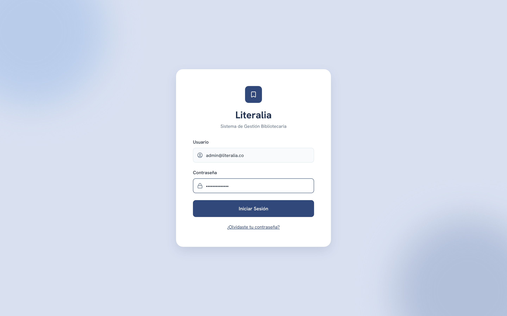 |  | 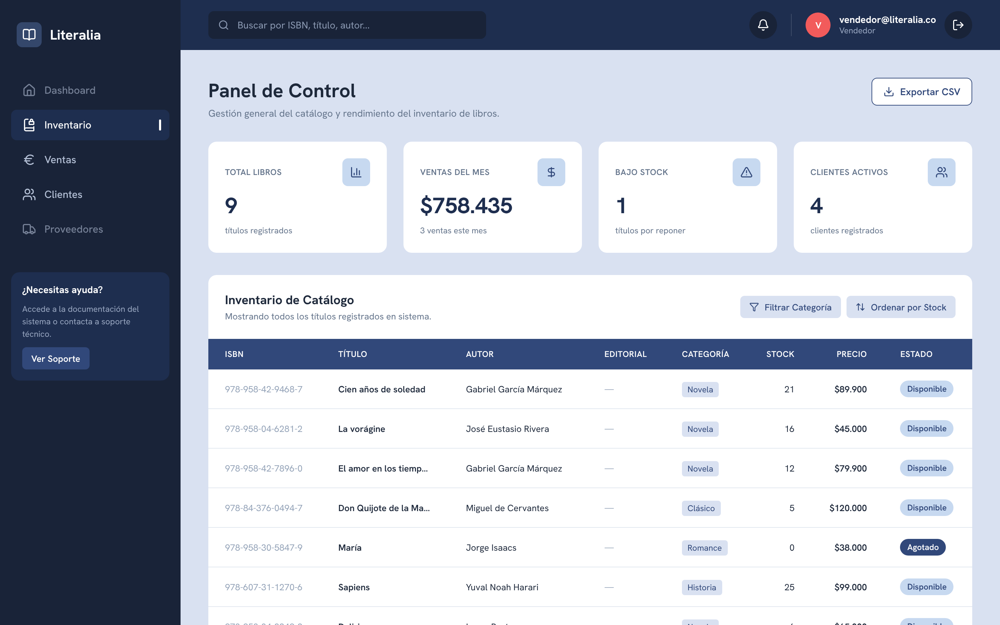 |

**HU-02 · Registrar libro**

| Formulario | Libro registrado en el catálogo |
|---|---|
| 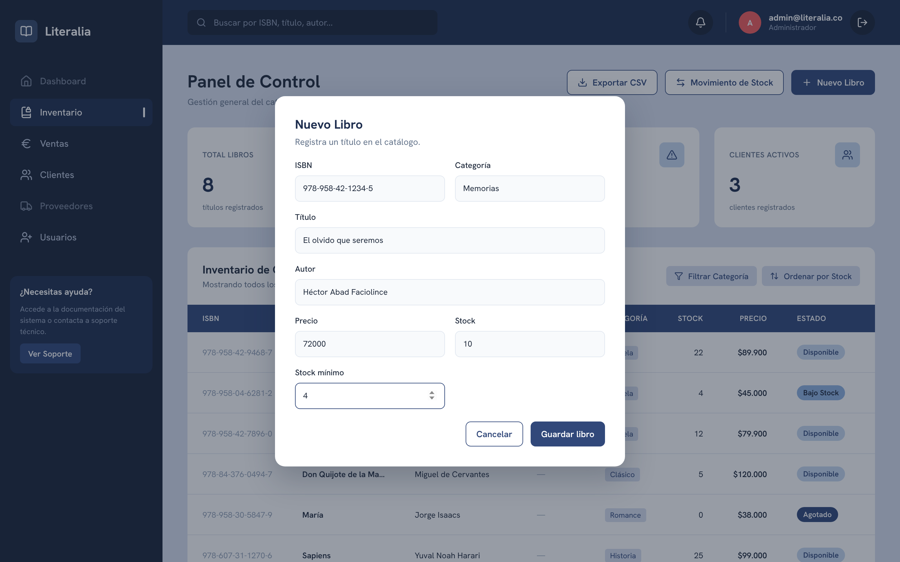 | 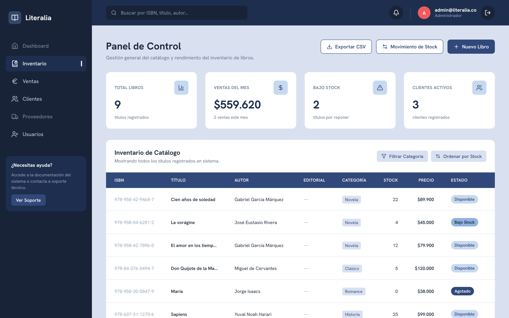 |

**HU-03 · Registrar movimiento de inventario** (entrada de 12 unidades: *La vorágine* pasa de 4 a 16 y de «Bajo Stock» a «Disponible»)

| Formulario | Stock actualizado |
|---|---|
| 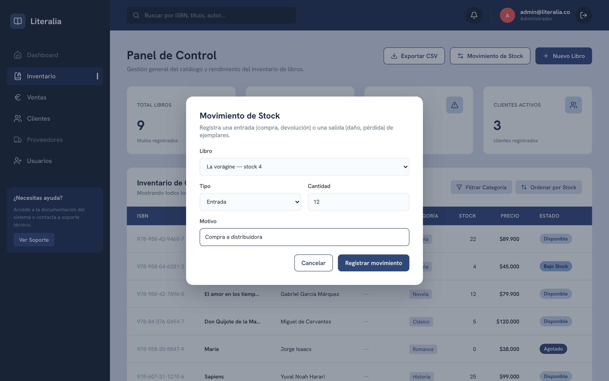 | 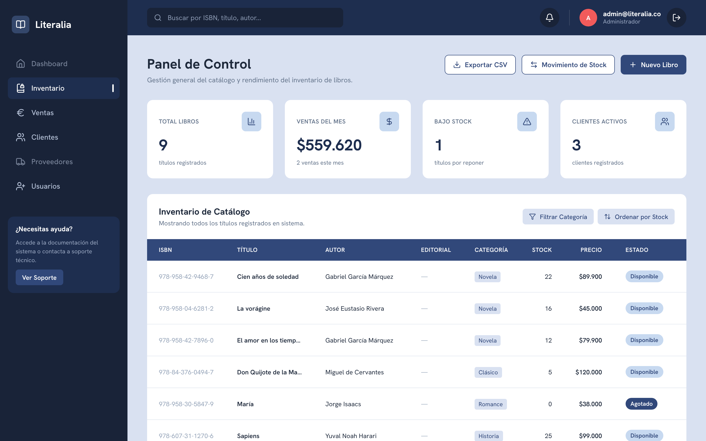 |

**HU-04 · Registrar cliente**

| Formulario | Cliente registrado |
|---|---|
| 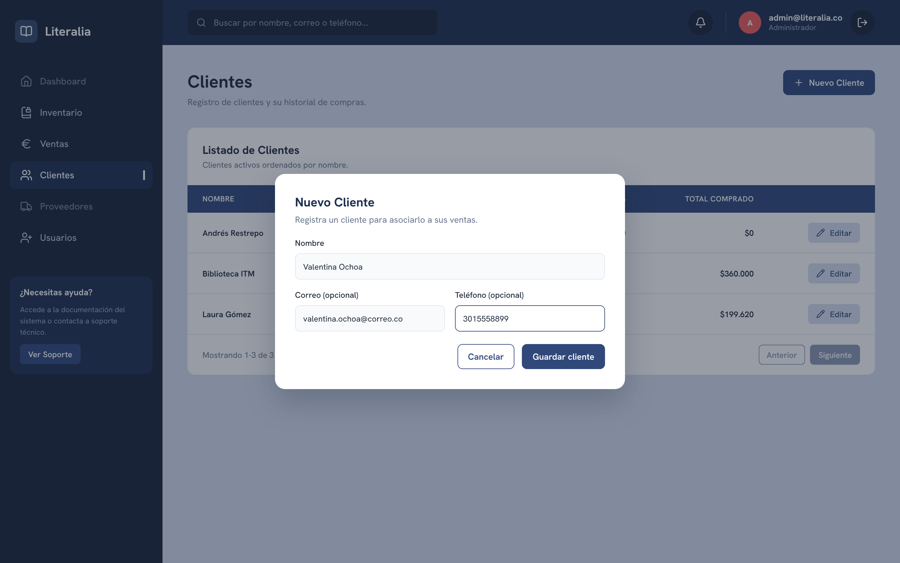 | 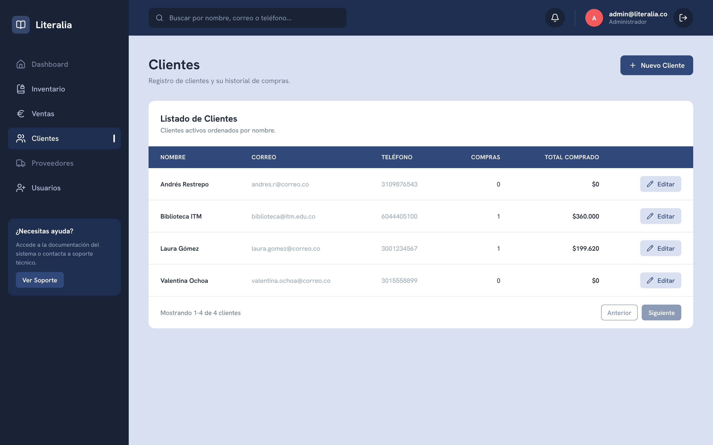 |

**HU-05 · Registrar venta con descuento** (vista previa en la SPA; el total definitivo lo calcula la API con Strategy)

| Formulario de venta | Historial | Detalle de la venta |
|---|---|---|
| 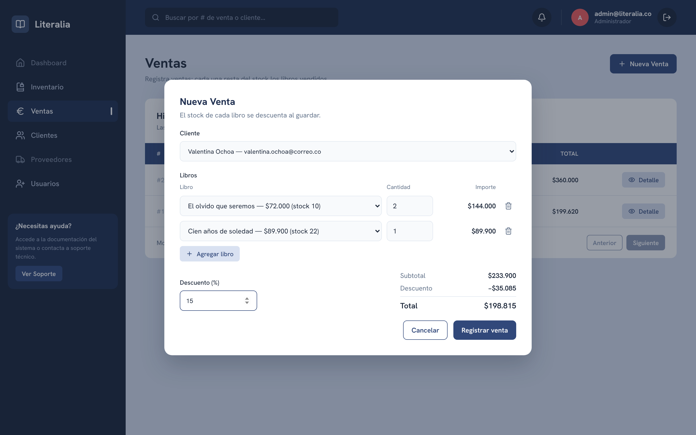 | 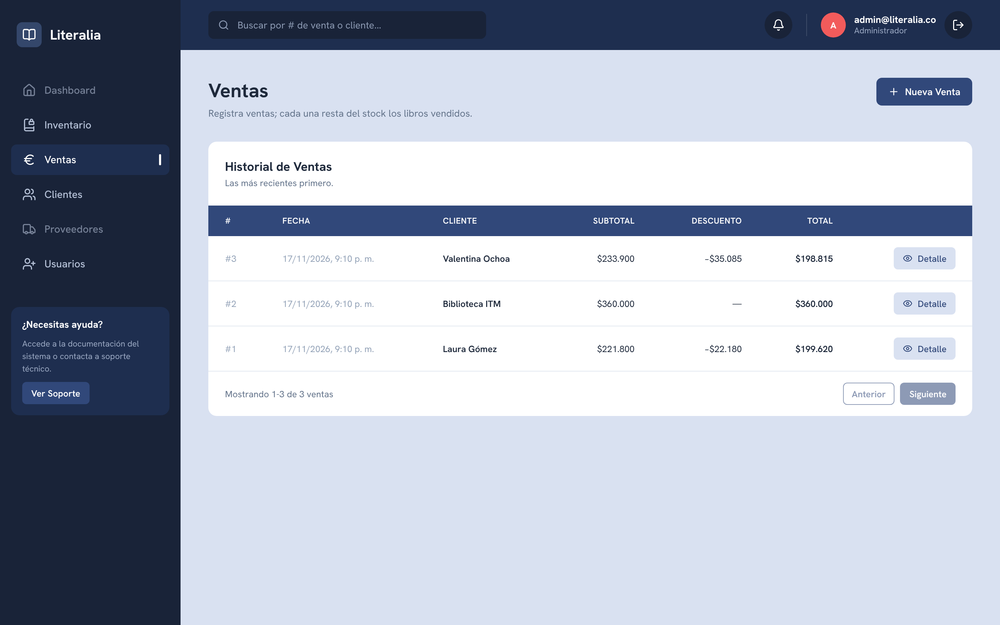 | 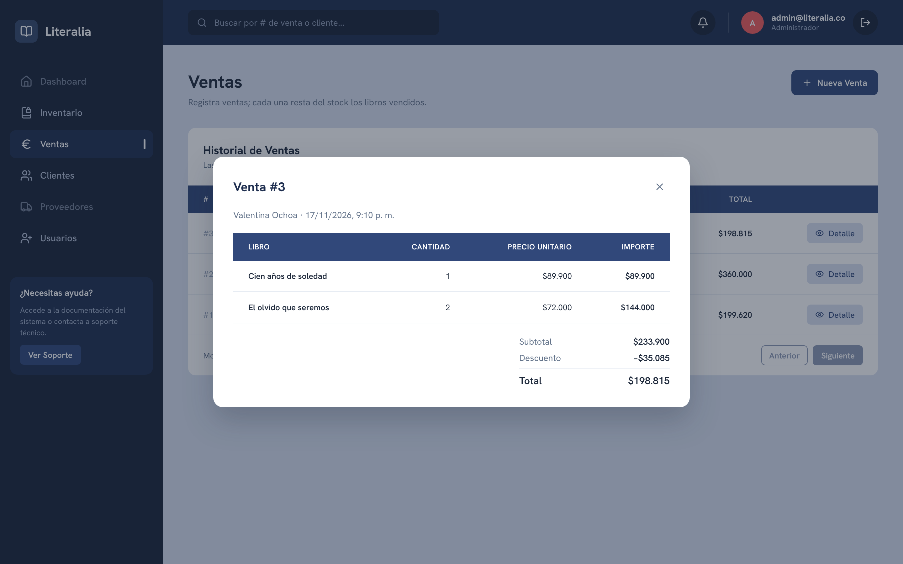 |

[COMPLETAR: si el docente exige GIF, grabar el mismo recorrido (Login → Nuevo libro → Movimiento → Nuevo cliente → Nueva venta) y enlazarlo aquí.]

---

## 5. Aplicación de principios SOLID

Análisis sobre componentes reales que evolucionaron entre entregas (no ejemplos aislados).

### Plantilla de análisis de principios SOLID (diligenciada)

| Principio | Componente | Evidencia en el código | Nivel | Mejora propuesta |
|---|---|---|---|---|
| **S** · Responsabilidad única | `security.py`, `repositories.py`, `auth_roles.py`, `api.js`, `libros.js` | `security.py` solo hashea y verifica contraseñas (líneas 6-11). `InventarioRepository` solo persiste stock y movimientos; `VentaRepository` solo ventas y detalles. `auth_roles.py` solo emite y valida tokens. `libros.js` solo reglas de presentación (estado, CSV, formatos) y tiene su propia prueba (`libros.check.js`). | Cumple | — |
| **S** · Responsabilidad única | `routes_transacciones.registrar_venta` | La función (líneas 207-327) valida reglas, calcula dinero, elige la estrategia, persiste y maneja la transacción. `main.py` además ejecuta una migración de esquema al importarse (líneas 30-50). | Parcial | Extraer un `VentaService.registrar(datos, usuario)` y dejar el endpoint como traductor HTTP. Mover la migración a Alembic. |
| **O** · Abierto/cerrado | Strategy de descuentos | `CalculadoraDescuento` (líneas 23-28) funciona con cualquier `EstrategiaDescuento`; un descuento nuevo es una subclase nueva. `requiere_roles(*roles)` acepta roles nuevos sin modificarse. | Cumple | — |
| **O** · Abierto/cerrado | Selección de la estrategia | En `routes_transacciones.py:274-278` la elección es un `if` (`SinDescuento` o `DescuentoPromocional`): agregar una estrategia obliga a tocar ese bloque. | Parcial | Un diccionario o fábrica de estrategias por tipo de descuento. |
| **L** · Sustitución de Liskov | `SinDescuento`, `DescuentoPromocional` | Ambas respetan el contrato `calcular_precio_final(float) -> float` sin precondiciones nuevas; la calculadora las usa sin saber cuál es. Pydantic limita el porcentaje a 0-100 (`schemas_transacciones.py:29`), así ninguna estrategia devuelve un total negativo. | Cumple | — |
| **I** · Segregación de interfaces | Schemas Pydantic y repositorios | Un DTO por caso de uso: `LoginRequest` solo pide correo y contraseña; `UsuarioCreate` y `UsuarioResponse` están separados (la respuesta nunca expone la contraseña); `MovimientoCreate`, `ClienteCreate`, `ItemVenta`, `VentaCreate`. `mover_stock` depende solo de `InventarioRepository`; `EstrategiaDescuento` tiene un único método. | Cumple | — |
| **D** · Inversión de dependencias | `CalculadoraDescuento`, endpoints, `database.py` | La calculadora recibe la abstracción `EstrategiaDescuento` por constructor. Los endpoints reciben la sesión y el usuario por inyección (`Depends(get_db)`, `Depends(requiere_roles(...))`), lo que permite reemplazarlos en pruebas con `app.dependency_overrides`. El motor de BD se elige por variable de entorno. | Cumple | — |
| **D** · Inversión de dependencias | Creación de repositorios | Los endpoints instancian repositorios concretos: `InventarioRepository(db)` en `routes_transacciones.py:72` y `:227-228`. | Parcial | Proveer los repositorios con `Depends(...)` para poder sustituirlos (por ejemplo, un repositorio en memoria para pruebas). |

---

## 6. Diagramas de actividades del MVP

Los cinco diagramas usan carriles (Usuario · SPA · API · Base de datos). Páginas 06 a 10 del draw.io.

### HU-01 · Iniciar sesión con rol

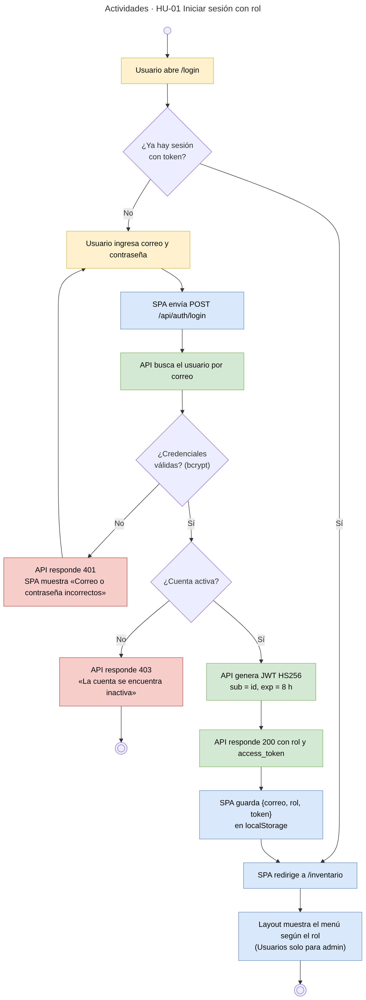

Enlaces editables: [draw.io, página «06 · Act HU-01 Login»][drawio] · [Mermaid Live][m06]

El usuario ingresa sus credenciales; la API busca el usuario, verifica la contraseña con bcrypt y que la cuenta esté activa, y emite un JWT de 8 horas. La SPA guarda correo, rol y token y muestra el menú según el rol.

### HU-02 · Registrar libro

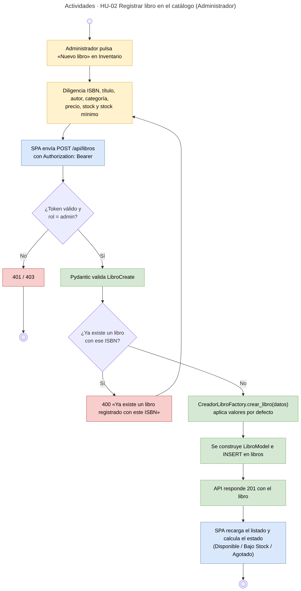

Enlaces editables: [draw.io, página «07 · Act HU-02 Libro»][drawio] · [Mermaid Live][m07]

El administrador diligencia el formulario; la cadena de autorización exige rol admin, Pydantic valida los datos, se rechaza un ISBN repetido y la fábrica crea el libro con sus valores por defecto antes del INSERT.

### HU-03 · Registrar movimiento de inventario

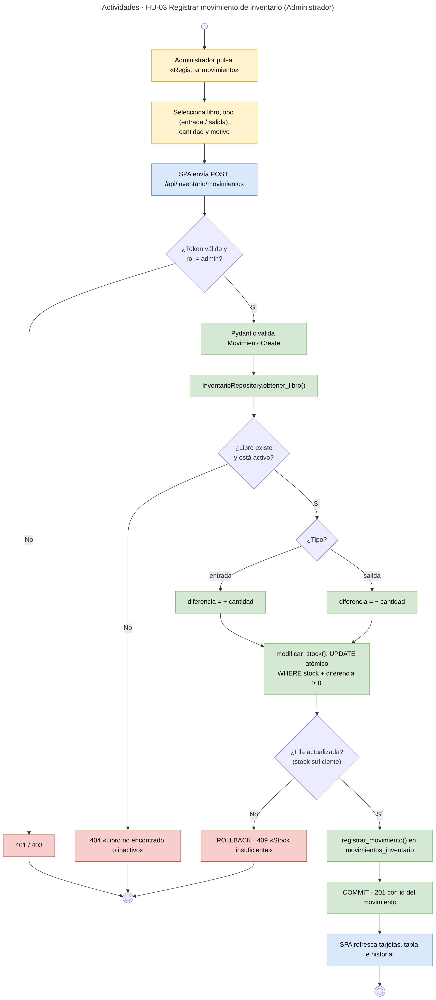

Enlaces editables: [draw.io, página «08 · Act HU-03 Inventario»][drawio] · [Mermaid Live][m08]

Según el tipo (entrada o salida) se calcula la diferencia y se aplica con un UPDATE condicionado (`stock + diferencia ≥ 0`), que evita stock negativo incluso con peticiones simultáneas. Luego se registra el movimiento para trazabilidad y se confirma la transacción.

### HU-04 · Registrar cliente

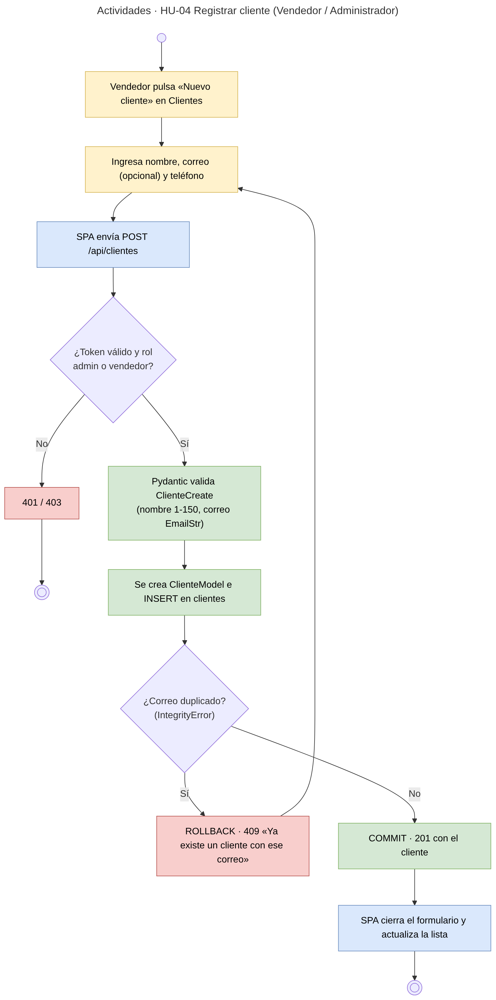

Enlaces editables: [draw.io, página «09 · Act HU-04 Cliente»][drawio] · [Mermaid Live][m09]

El vendedor registra nombre, correo opcional y teléfono. La base de datos garantiza el correo único y la API traduce el conflicto en un mensaje claro (409).

### HU-05 · Registrar venta con descuento

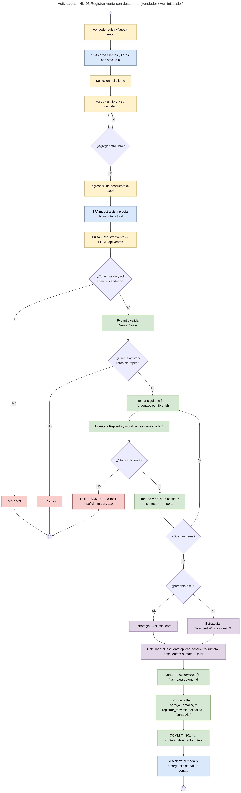

Enlaces editables: [draw.io, página «10 · Act HU-05 Venta»][drawio] · [Mermaid Live][m10]

El vendedor arma la venta (cliente, libros, cantidades y descuento) con vista previa. La API valida, descuenta el stock de cada libro, acumula el subtotal, elige la estrategia de descuento, crea la venta, sus detalles y un movimiento de salida por libro, todo en una sola transacción.

---

## 7. Diagrama de transición de estados

### Libro (disponibilidad por stock)

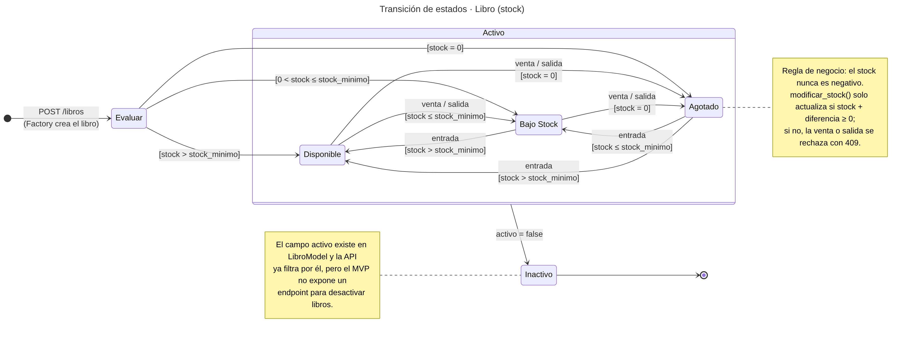

Enlaces editables: [draw.io, página «11 · Estados Libro»][drawio] · [Mermaid Live][m11]

Un libro activo está en **Disponible**, **Bajo Stock** o **Agotado** según su stock frente al stock mínimo (`estadoLibro()` en `libros.js` y `bajo_minimo` en `GET /inventario`). Las ventas y salidas lo mueven hacia Agotado; las entradas lo devuelven a Disponible. El estado **Inactivo** existe en el modelo (`activo`) pero el MVP aún no tiene endpoint para desactivar.

### Sesión de usuario (complementario)

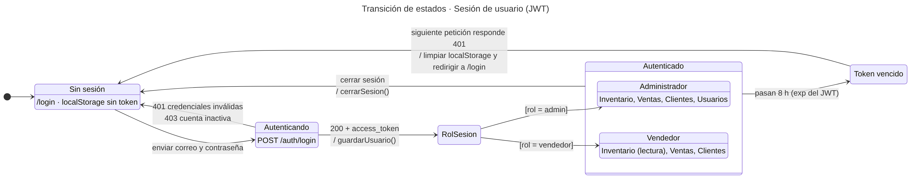

Enlaces editables: [draw.io, página «12 · Estados Sesión»][drawio] · [Mermaid Live][m12]

---

## 8. Diagrama de componentes

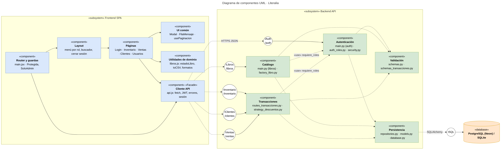

Enlaces editables: [draw.io, página «13 · Componentes UML»][drawio] · [Mermaid Live][m13]

El frontend se organiza en router con guardas, layout, páginas, UI común, utilidades de dominio y el cliente API (Facade). El backend expone cinco interfaces REST (`/auth`, `/libros`, `/inventario`, `/clientes`, `/ventas`) provistas por los componentes Autenticación, Catálogo y Transacciones, que dependen de Validación y Persistencia; esta última requiere la interfaz SQL de la base de datos.

---

## 9. Diagrama de despliegue

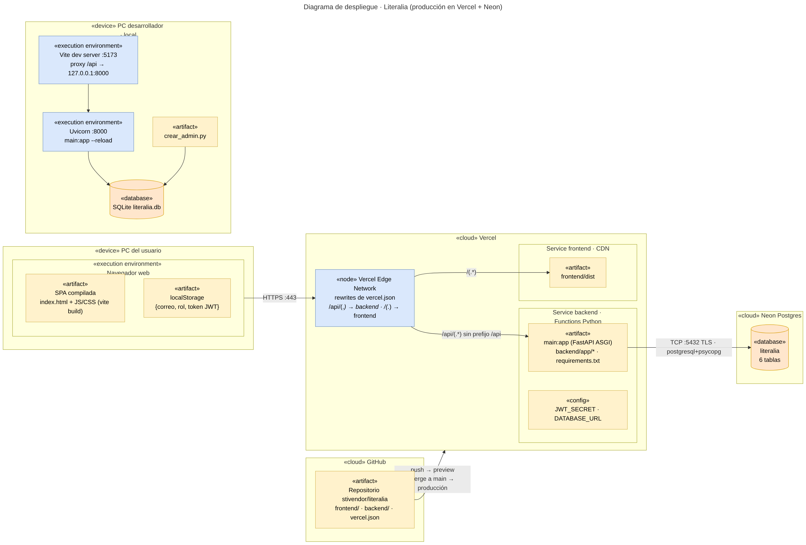

Enlaces editables: [draw.io, página «14 · Despliegue»][drawio] · [Mermaid Live][m14]

En producción hay **un proyecto de Vercel con dos services** (`vercel.json`): el frontend se sirve como estáticos y el backend corre como función Python (`main:app`). El Edge de Vercel envía `/api/*` al backend (quitando el prefijo) y el resto a la SPA. La API se conecta a **PostgreSQL en Neon** por TLS. Cada push a una rama genera un preview y cada merge a `main` despliega a producción. Abajo se muestra el entorno local: Vite (:5173) con proxy a Uvicorn (:8000) y SQLite.

---

## 10. Anexos

- **Repositorio:** https://github.com/Stivendor/Literalia
- **Figma:** [COMPLETAR]
- **Diagramas editables:**
  - draw.io (los 15 diagramas, una página por diagrama): [abrir en draw.io][drawio] · [archivo en el repositorio](literalia-entregable3.drawio)
  - Mermaid: carpeta [`mermaid/`](mermaid/) y enlaces de Mermaid Live en cada sección
- **Plantilla de patrones GoF diligenciada:** sección 3
- **Plantilla de principios SOLID diligenciada:** sección 5
- **Capturas adicionales:** carpeta [`capturas/`](capturas/)
- **Hallazgo técnico para la siguiente iteración:** `POST /auth/registro` no exige token ni rol, así que cualquiera puede crear una cuenta de vendedor llamando a la API directamente (la pantalla Usuarios solo la ve el admin, pero la restricción está únicamente en el frontend). Se corrige agregando `Depends(requiere_roles("admin"))` al endpoint.

### Bibliografía

- Gamma, E., Helm, R., Johnson, R. y Vlissides, J. (1994). *Design Patterns: Elements of Reusable Object-Oriented Software*. Addison-Wesley.
- Martin, R. C. (2017). *Clean Architecture: A Craftsman's Guide to Software Structure and Design*. Prentice Hall.
- Fowler, M. (2002). *Patterns of Enterprise Application Architecture*. Addison-Wesley.
- Brown, S. *The C4 model for visualising software architecture*. https://c4model.com
- Object Management Group (2017). *Unified Modeling Language (UML) 2.5.1*. https://www.omg.org/spec/UML/2.5.1
- Documentación de FastAPI — Dependencies. https://fastapi.tiangolo.com/tutorial/dependencies/
- Documentación de Vercel — Services. https://vercel.com/docs

<!-- enlaces -->
[drawio]: https://app.diagrams.net/?url=https%3A%2F%2Fraw.githubusercontent.com%2FStivendor%2FLiteralia%2Fmain%2Fdocs%2Fentregable3%2Fliteralia-entregable3.drawio
[m01]: https://mermaid.live/edit#pako:eNqVldtO4zAQhl9lFG7TQpdSSlVVorAHpF1UiYobwoXjTMDCsSvbKVSId9-xc2gKrbQbJKR45re_mfndvEdcZxhNIOr1eolywkmcQBJdDSEpT07Sc7gVa5QwaF6vtHL45jRktGqFdVgw-C0cGiYFS6JEhY1yqV_5MzMOlvNEAT0sK4R6oIQyG59m9J-PhjBNZ5d-nfYxLNNmepzOpqk5nk1twaScPSzQWK3Y4_S4WgjBn2idoFXgzHksHEj9pGOwTvMX2AAvUTlmCRHWqDKkjfuwZEUqQvaFglWJTdD0k-ixQmyS91De16F_A6Qm2VI6BkKtPYoRRGfwKZQJXApaREukIWq3BFwXq9CIPQhXlWybc4gFaD5ovjJ5GUiRGm0BFcjqBU1oSsb6cKuhtCRvB1uBVWiymTGhEU078i8Ud7UpqMFW5-6VGdwzPn9ofqp81g7FZKdnVX_ibstKW_qYpT4oMFqi7VKujF6jHxTaivPzYZ2Eg-S11fOSKgw-_3O_2C3hckVVcfRtpHCBKpzA_Gx0kLN0YapT30TBCg8fdk27sOFKQK9H9-1GCS4YWLQNbMcw1czicHKh16LwzdDB343lG-tSVd2Kfi2Xi7sWPYnosNl2kruuPwzC99g5HHPY0v9N0boaen3C-G6BOQITmYaVNqTpk6ZB_eTISnJDAE-G8XbaeelKw2ppZ-5N-7lk1l5jDqtwbyAXUk6OTsbDb-fzmMrSL0iv56fz0Y-Ya6nN5CjP80_a-q7JWn0RnlY9vvR_h9V24x1XaweD0Xh-vT15PhyPh4e1oTystRieVusZauFoNKqXexmz9JNs2GYCZ3DW2a5yYtw6oWpIN2E7nqbgbnQ7iaqgbqzT-Bo5UVEMUYGmYCLzn553n59E7hkLTCL_-ckwZ-Q4_zn58MmsdPpuozgFnSmRVspVRga5FoxGXtTLH38BO5JQfw
[m02]: https://mermaid.live/edit#pako:eNqtVWFv2zYQ_SsH9UuyyHGWeHFmeAZiZ-lSBJkbu9mHqAhO1NkhRpECSaUwiv73HSVZtrKu64Dpg0HRd4_v3b0TP0fCZBSNIOr1eon20isaQRLNBpCUJyfpEO7kCyk43b7OjPakKTOWHGQEt9KTRSUxiRJdYayU-SSe0XpYThMN_GCWS_3IAWV2cZbxrzgfwDidXIZ96bxFhhv308k4tf3J2OWo1ORxTtYZjR_H_XojiT7WcC-ks0DgK4gPzV_fB1bDuTJdWyyeQW2lACO3urbCF0yUcmxZhCeTloSXRrdSK8ACGSDoK5QUKGRAWJ1p-EQpHCzml4d_o7er6gjuCYWHH3-GI3hgEnDBi3rv3pRMCoatigpjjtrzC9btMGupY7jRXCSPVpoYHsLKxTBTklfctQ18cGX4zx3DW15kCNzhd38sgTQoI1AtvLG4puOOWCxkI2t-A_e_LpbfVDHf-GeuS1O8a3Q-pB3B4v3tpRLPlG_YU0ccljF9KeC0K-qe1o0iTWsjgg5k8SF0r6CBs-BTrFHECuWearFTW226rpgsfTyoxEzRUTgmQ2_ctxUZ59eWWAAc3JHRh6FchTVZKXaMtmZ5H_zT1rOrTcnUGqZbNl3YkY0brjEzCj0l91RtxJCbF5mHIOOedjKT6HBPE6PUDVoIKwsPwhLap2r4jovN93RrdnvTpTpjiGCOwsqcnYf7A7srKA_ddpiqCOj1-BPywWHnvN-Wy_liWyCNL7QOKHsTyWmTMDzdKf9fwHhR49wqzBH67OX-Dx3Ad4vf7_od1ClXjzWzx17DcnajtpANLBEbjRwXPqUObrDLzhRb6_ehcBthivVr6CytkbmXNfKNdmQ9bs0SrP5LVeR_P-Vr2Ft0dO6KVlBUn0VYSaVGb04uBqfDacztNX8Svw7PpufXsTCKHfJmtVq9yuXB8yg1l6hOH5xdXF391KafzYbXs5N_TueBwzQM33_Ork0WtwapRewHcLtj7k0cqtjS3A_I0vb8xiB-o2jvBqhJraqnJTUYDJp1L0PHV5zFzQjOYZDoKIaIJyRHmYXL9HNATSLPbaAkChdqRisslQ-35JcQzF8zs9howX96WxLvlAVToiuJfBvlzfaXvwALCX_P
[m03]: https://mermaid.live/edit#pako:eNqVV1Fv2zgM_iuC-9ICTp216VYEQYA2We92aNdckt1LPQSyTCfCFMsnydkFw_77UZLtJnWabnkIZJqkPpIfKflHwGQKQZ8EnU4nzg03AvokDkY9EpfdbvKBfOYbEOSyfhzJdSFzyA1okgIRlNxMPpHpx9mcnCaUfYM8jc7iIM6dv0zI72xFlSHz2zgn-NMFfYqDQTK8KQRnlHHrN7vMyXdIyOlscnM2iJLhIFHRcKDXVIjh00jibjmkUvXJFCgzXweRfxUHX73XNHk6dV5vqQaLK6VG6panidRmqWD29z2JCP5zAzu-ztBZBbJMlooWK0ILThBuE2KVhDuqDcqa7R0EroAZLvMm1D1PzChhXZE9o33D--n-mzXlOfPZsjlQUlBMArnniZKabMlNaVYHslUXqO8cnBfbJkan-MfHeTR5nOHflzmJhHdWBWblJKLoNxJyyfMDcgVLrhFLKw4lSySFhzu1a0XmiuaaMobBgT6K1BsvzK5BC3nE8w2qU8VlDWxHFK3lhq85Pj3HEzHBPVdrgdPWe-CRsgcKpjfsd-tl81ORG6PBZtrl9xZjFG9kwTpYOLVW7EwBVQsjscHqWEpd2rgX2BElFbVUwb8lBwXej9-KD0crpAKRGTaQxu00T7jgZjuI-LAVoIaKdDNYloqnNLUdxSwDsbtcPO_o8UDQBVqabSuMFdUr7L0NKJ7tpSdhaluYNha2gjWtWDWeP7qhs6ECUTW2x5F4BwikTlAleYNrk21KbQX7vt1GmH4DIbm3XTHFFIM2IfnHksm_isuL7sX7Fv4MiyPV1uO_swjgXaIwcjc8Xe8dhV9Qg42U66hytHA2LbRY4TuvQB7ArGR6uLAYsoFlhWbk0QhWCulGJmhWuu75NUS1t8Wz4SFcs0qthehw2-Hgpr_bdwoKWQ8eu-SYCP5GGKpRPFD8T81Qafw19HE1fxa3YK7xPBUVmge7xmn0OH04PqedTQuGY57zEZIvvtmrp5Efa9WTg-TWr7DQJjXB3m3OkoxjZ-90H5b_dnwUYu2iBRJy7AioszMDrbFE95I9T6QlmEWaNHzg-VKAkfnrhHCL5rpAOh0kw1-zx8_Rn_P5ZIbc6HSG_nB8S8kfK17LGTipHbMvZTixWiI_KF6Kq058KfY19FK_7Yu9doR7nnflVa-0Xji2eql12N7Qvm9J_dqJ6_LtoT7HlI2hwHTrU18kvLmR85Z6DeRX9esnXxS8Z1XVSJO6rExQrceQEfjPkIwL0T_pXV6Px1ehvVp8g_7J5ejD3agbMinw2neSZdkLQ4bcrCyvr25v77qN5dX4-uLmurbsdrs7lpYqYZrYbXelLh-hDzO0CQ6RDmFVpbAqeFhXJ3TZDn12wyZYi6jio9kKcHdHDzBzvwZgr9er1p0Uj0OqFN32yXvS27V290VnnmML1rZ2vatlLylvKrmR-opWEJJgDQoTkNqPgB_WLg4MBg5xYD8EUshoKYy90f-0ypgdOdvmDF8aVeKJGJQFbgBjTnGAryvxz_8BcWQEKA
[m04]: https://mermaid.live/edit#pako:eNrVWG1v2zYQ_iuEsAJ2ZmctNmCAEQRo4w4YsGxB0u6TAOFEnR2uFKmRlAGjzX_vUZRlW6KcFyAf6i-WSN7x7rm7h0d9TbguMFmwZD6fp8oJJ3HB0uTqN5bWb9_mv7O_xQYl616v_P_q10Ks9YIVuhRK6BkzWGkrnDZCW7ZlFTijFVo2yYF_QVX8AlU1TZNUNbtwCdYuBawNlKli9CuEQe6EVuzTh1SFMQUl2go4smXYJvvn9joryVxps2rLvoZl_tcoZH-J3OhrP384538_C-WYKHqD1hkmbK4a1yCvlfi_xsbNPLKSoKmljkxATX5Hxjk4XBMi0JtbSQ2OVeSw0BEzrdP8y9h45oEo-2K51pIB4bc5mHnow_PZ1kDxeSZASpe5wZh72hjUT8OOa-UMWFTQrr8He89ybraViwo1HqF1UMQQNzQZ9EBBgLBvbEM5hgWFoadsAMKVFKgcviIIM6YriqwCOZ5KKHGl1cvC-C_ZD8-w3w_y4HUWnaxDXgwnl5ShJUhm69xpR_7Epwu0vCb1emQ-JltQbThRIlshv4cT3i6RhCW-xOmNl4m7LD1TxKc4EAkWMIZFKNuMQu08aE9GbODYtd6I0kdF_6kaS59Xmo94MRrTwGTVLmXR12UBVEEWJLkdTdkTsHh1pT7O2KcE-GFI8jdorLAOFReQ7c8TjHP9HrTb3dJtH7n5HVrrz5Si75HOaR80WYPgZIfj9OAE6QnQqSNWgoPJGhruRGZ0cq3QNEZPmS_gnqDBNTllSLDsAn4gvY_TrAnLrAN61uI6Hc-Ux0jiJchwg2Ame744NnGX17N90c9CfU8PeKmnko55XBMARSjlya4uZ2yPw97rUGD7raZDCnhKNt0R5nT8bjO7e-gsjifUx3ahgOVuYR-1iwvI_SruLi_7sIHktSQnW35YCeL_SftCWbz27wvWHP3Ts_B_Inx3Qo1a8by9Ht2q2-fG6FKHg2uQLm3Log33QfgPX9Wiq6CNTvPxUMxj4cJurJ-BlWxqt0uBZ9oWya8_KAuosLJV-x9SOZZYV1RR5EtDLa3UMKS-6lo2IubUllprwd30p8BIH6h1OgFYt2agd9fh_jDtbB_wN2_YLUrwaUm3CX86tlcONpESNjS2Ck0fvlMIdhqkDrqFNDlLEzafX9LTO3o66v8Wg8bohORR-7w4oEU22XWfse296Nl87p_Oz73GYUezaPpjMqQN8nBF35aDm86i1waM9xWvomQUlaMI7i-HYTB6ep-fXx7b9Plm-f7Tx5ApDFy4eJaC60eUjFtPSFOlHUSpJ3kclJNLo2FsJDq_d2dQGIgx1sU3yoxDsn9kaYysg0iUNLWPU0zZ4ogrO4Nbemo1RnirC1HDNou2ifRuu6PL337NIKg0VkKFwGjjZMaSEk0JovBfIBr2ShN3jyWmif8KUeAKaun8h4MHv9hz091WcZp0xl-1krrynWb7LaEdfvgObF0qXw
[m05a]: https://mermaid.live/edit#pako:eNqNU8Fu2zAM_RVCp3SZixQ7DAiCXNJulx6C5TgNBiszqQpZMiRqWJDl3yfZsZcEDlqdJOo9PupRPAjlKhJzEEVRSMuaDc1BijWyl3E2236x8N19gwfIp5evsGGPTLs9TJSrG-cZa02W3V0PqCiomCMByMLvtMMghbRtfmUwhEeNO4-1tJBWpT0p1s7C848u0mLA006HpOXLNkVJtmqctvxTiqurySC9MrkUkuIXHLpceS0W3kWmUCaKDahUEqNw3-yXyw50PNddoVHRYOU8PvYvucy2cknjD7uenlfxFDpf9BmLhth_4BQbo1UqfbBp0iQDdPJvaxzySEVjqS8KwpeMUHzdovMCp6p7ly87uXKrLZpe-9NN8Y22t21Qnpiu1S7oA3ftXe2y82g-lqZ1ta0K0i9TudFvNCh0m1t_BIpiOd7IOcRw6sbovcvMEcM7ylgnFn-L4sKld6BjjkgrPoOoydeoqzyLrUNS8CvV6Tfneaxoi9FwHqRjBmNkt9lblS7ZR0qR2FRJ8DRbp_DxH31ITQc
[m05b]: https://mermaid.live/edit#pako:eNptUkFqwzAQ_MoiekhobUJ7KJjgQ1PSSwqhPVYlyNKmEciSkdcHE_L3SnIcHPDeNLszsxrpzKRTyApgWZZxS5oMFsDZXpDn3Wp1fLHw4bbwDPFUvcJWSHK-h0-kk1OwkB6F1M4KsxxHBmhkKwSjK-9azrhNJtKItn3X4s-LmlsIpbRHSUEFdl8DkmaSkj8k-gGtapy29MPZBF7cXDdGoyXk7BfOg0as9boW2uZNX5YDeJnqb4KQcn4XlcaL3ZHjQEBHcqzHqbsK3bYI-0taPkDSeRMtzljdevcGe-9UJ2my3ZU0c3PIsnJ25QJaZ7TUJAby3Eyel5MdipSaqKJNyCwmWHHLnoDV6ENiKv6ItChndMI6xBp_hcKj6AzFl7zEYdGR--6tDE3yHQaka0IkeH3cK3z5B5UkxzE
[m05c]: https://mermaid.live/edit#pako:eNpVUU1rAjEQ_StD6EFpFcFDQYonbS8eSj02RcZk3IZmJ0s-oCL-9yYbF7chkMzMe_Pm4yKU0yRWIGazmeRooqUVSPGO0cu0WJyWDG_uFZZQrOMz7A03lqJjmChPqIxjtNMhqhzTrxmICBbhiIFA54vRBSkk90LKYggbg43HVjLko40nFXM62H1UT48pPCw5Dt35U4rBmnfnQbOtcjpZJ8UXXCq5nJeXe7Wd82Pken2HPRI3hgm2_fMwCuwphFzRzim0EKrR4g_5MaiheNDHyRRu6Bq6jnvYsu6c4Rj-V7ehjliHSc0wHWrK1Pq50-bz9XgQsILECMHl-RoOEVkZLEOunUgWTyBa8i0aXXbbq0oRv6klKcp-NZ0w2Vj2cS1gTNHtz6xyMPpE2ZO6LEi3Fd3c1z837LMy
[m05d]: https://mermaid.live/edit#pako:eNptkk9Lw0AQxb_KsCcFA9UKQik9-LeIh1ILXgIy7k7qYLITN7NikX53s4mFNnZPu2_e_HYneT_GiiMzAZNlWe6VtaQJ5GaBGvI4GhVjDw9yD5eQTm9XcPOO7EEKWFJTi2_4jUvWDZxYqWoJihWTVznd-TFqe2aLlne8DQQpqclN7rtLbYlNc8u4DljlHtrlOJBVFg9Py17pPDBfrRbXhIEC_PR6WtPpHL0rW_F8dyt9a0AClQ_ys1lv3e6TYhMxsLyi1YjlcdrFjvaFJTuEx5dV-3ZqFJ0chQb6jEyBXrv5jkPHA2hrPcq6864W9roIorRmJ4e4JVmqVQIU7HGf0G_2PlSWzYbTTqDhdUz_iXr7oJ5aBrP8axnUU8v_Jx90mTMwFYUK2aW8dePkRt-potykzDkqMJaacrFN5jY68rzxti1qiNQqsXao9BeVP3n7C-Wt5uU
[m05e]: https://mermaid.live/edit#pako:eNplU11rGzEQ_CuLnmyaawOlFEwwhJa0KS6Y2m0fqhDW0p6toJPCShdog_97pdPJH4meNKPZWWlX-yyU1yRmIJqmkS6aaGkGUiwxsuwvL9v3Dr74G_gAGW0-wg0q1AQTCpF7FXtGO61nyhpykeB6eQuaLLTsE3RaCukGe2UxhM8Gt4yddJCWNkwqGu9g8aMwgwaWuDUOwx8pFj7taoZb95QyIBtfmV8Zh4o-lRsc8M_QZ3GQ4g6ei39eV1cHYXqLRWhR7VDjfF40-9Or4KO5f8g3SZu3D6-tSkVqaF5vbL7zRHlm8hegUhUYAzmcnmi2FBdmwz5MpvAOFBPygAeIqbJozb8DdxI4SL_7J9PlJxR9MjsyYfIiT33sMdPIvMh1YM_DS4lrngEdnUZ4HjGWfVBRuNZdqsYQQczIKwqp4TXmrNarfhNMiNRhqndLUe1qJ61XaFfRM26pct9-r-s2GXtO7fy6Xi9fdejoCl71NvqTPpfN-N2gaeZjv2EGfcByOjL58MRqVsySRlyA6Ig7NDpP0pBbirijjqTI06SpxSTNc7DPYuyjX_11Kh2mKaLE9I8aI42jMdL7_-F8JHk
[m06]: https://mermaid.live/edit#pako:eNp9VNtq20AQ_ZVBebFBxpJ8xbQJvsQkJbQBJ5RSlTKWxvZSedfsSmmN8b93Vitfe9GT2Nkz58zMmd15iUrJG4DXaDRimYs8owHE3jDJxZtIMSUDcREE8x48vDaCEB6lSARqMGSEDSxaEhIlQass9mJZZllk6meyQp3DyyiWwJ-QolaDeh0ajVvA8GvsvZoCtVCAc03QzNRSyNj75m5jWN5Lgx2ntOSLLwgr3J6Tvpvr5q0lztUPknext3fYNGAsFzCz9yiNvYoyuAx_VIdIdCZGyKUmg1yQ1qRgayvLNRoqSUM8KYwcuMXg2fMQSL45PoTnT7MXaOJGNLHIV9eVtRyuzbjh8yPMC5MgUAZFpWCjdMV-wrRdN8JjN8aaUpI8hoxM2QdHHmY8MHMHtXmit5u8fupJeFU0hRU_V7tRMiVoB2GZyRazLshw1eXccT52vVDXveBmlUKTXJlS1vyomMKqtZf0lyNJo1M9BckcAa3n8GyU0bXs6E_ZrVK2k_rEk3OpDPFIyn9thbrM1yrdDBdCRrXSnPVL2isHdSruJUnipB8-v8DDLOp0S35TzOE9iNQH-rXhvz6sTvPruATda_FREBxWh62GSULGfC_tfMJ2HbZX-WzJLmGP7ZxFfAv13QbsSx0kIVMJZrNcaVzSKU_vsAZVInaQ0GJJgNAU8s02je13toFBBbBOecKtKvKjL9iua9ZobWA7vXR_0p6znlJHrdooA0Zl7GpkGKZrIetnFOGh_8f2u0iSoTETWhyXYiGybHAznU6j8dhnCVzv4GbSHXU7XT_h_HpwEwTBFdhssAJOhvf96QnYHffvR9N_A3l1D8DOfX_SPgL70ajV_Q8jaX2Q2h_fn0kd9TvtTvB3IPfB59ekKvUi0PKx5_MkfNsqLuci2Pax47M9WO35OYU--5qVxNLzwVuTXqNI7fu-s9diL1_Rmn1h3_iUFlhkuX229_Yyv1dqtpUJB3NdEJ8UmxRzmghcalxXx_vfGAvifg
[m07]: https://mermaid.live/edit#pako:eNp9VNtu00AQ_ZWR-5JIDnGcS6MIinIVlaBUTXhAGKGJPUmXbrzReh0IVf-d2V3nUijkJdLunDNnzp7xY5CqjIIBBI1GI8mNMJIGkATD1IidyDCjApIyipaX8O5TI4rhjtaiMBo1SLHUCigHkpCisVXUkmqtoDbMNiJ3ZZnS9SRIcse-kupHeo_awGKU5MA_rqrVoF6HRuMKsPWFG59DYVvKAp0AXN6UtFO-q1O0tL2v8x3lBrVQSfDVc2LLs8XMNhFSrClPBcL1fHQTgpeZmVKqELA0SodWPK2V9jcYvl7q5tVWUyq4pDAqfYB99b_xNbnYnLWLfbs2t5vfDlnUrmKC24_zBTRxK5pOdeGYU5XDsDT3SotfaITKBzAi1KRPjG3HmLUe2Tk76WqhHnjWXWWxyBTsHZdWEt4AWsveJsGTh2d2fn7CG9boiMj62ola0IRO1OY27nQl8rjmzK8_x829_AqMHQbf7jPkbKSwQ-6O8N6OM9bExp1Ud7zq-Kj6MwL95KckKHP_bkcDqCD3IGeq45e6U-ykR1UE_mYEXeWRPfHExjP7iByGxfh5l6M32OUGdhJOm5tqhimHYv8q5TP9zfWoZWhUUXficStFitYHpXk1tpzRjFbEmJMRXc_cs4Egq4r1lXvyrn3gdZPAGm_m07uFjbDPxgne8_BLuwy31zxgsVV5RhDzC7oRZbUER8SlR_SrBHJ0Ua_RFxbGWrPnkMu0lO6Q3JkbpzYRll0sJXE6RvhdwdwlvQnDtbJl9VOb_iE3x9j4i1RiUUxoBWVR2k3kEikHF7PZLB6PQx6e0zu4mPRGvW4vTBU7N7iIougPcLHFCjgZTvuzE7A37k9Hs38Deb8OwO60P-kcgf141O79pyNpfZDaH0_PpI763U43ehnIn5eQV74a9dlFO2SLeIxnh50QuyH2Qn4kFnp-Ra2QYisiyYMQgg3pDYrMfoofbVkSmHva8H7ZzzFnDEtp7Jf0yRbbL9d8n6d8ydkiPim3nFKaCFxr3FTHT78B4_bSOg
[m08]: https://mermaid.live/edit#pako:eNp9Vf1vo0YQ_VdG5Bej4hoDdojV3smfulOTJop96g-ligZYLtsD1lrArRvlf-_s8uk010iREtj35r03s8OLEYmYGQswxuNxkJe8TNkCAmMZlfzEY4xZAUFl2-E1fPoytl14ZF95UUqUkIkTzzjLSwExA56f6E-UXMBoGWc816diIc3ACHJNnqTir-gZZQmHVZAD_dCp0QhME8bjD4DT36nuEArHKi1Q18fwvcJaWRgYf9R0OK2JHCLas5RFERc5QspDKSwo-ZG0EYy4ESZQYEoGTeunUE4-REjeyS6ciZ6si57UqUldRfqwBJafVFlGHA_3-wNM8MgnvftJr67oOVzNEU9fKAylOTmIbyyHmmlKOgSctQ4pUvgZUKXwMTBea3isfFFTfiVVmoipqDx7Si4826Uy-mnCc2ek8zQvcftacANGj8AP51g5juCkU4C7TvVaMixZL92rQTMCfe5cPrKjKHgp5PlHEZYsZ_JJpzwye-Cs9ux0nm_VCWB_UxuZNnsGVpR1BIBq4MTAs_PWs6M9e8041GQ58eWR0D0VIGigap5uMLpgLlkvE4ndvi80JAMRbn28GZo2wDmSlJgnTFJxjtSwH6AdoM5_i63HrIOGb6FB5ThT5794qlJDrgmRCcLwCOVTUYro28hcwJeHzfKwBdQBJm7GI6FD_e3T9nEL-hjJGpRSheYzsAcVwqZC8_91nYbXpbHjKarOVOThHwrgo64wqsmLihSpkWFmH5j3tmvq2jze396ulutf2k3i2TdNF_eaiec913c75707yz7Ry3YzPPV3b2TSYAw2RfHUX9E-AL8muSGS9f3d3edDq9Chu0VjBTym3ZYON06HvWmWlt3sBckSyYoIgWr8yUosaONgSPkxeCZ5QnJMB5vKbv11N7Z-E6VYFBuWQFVUepsmPE0XV7vdzlmvLbJJi2NxtZmv5rO5FYlUyMWVbdtvwMURG-BmufV3PXC-9rer3feBtMxa4Gzrb7wO6Dsrd_4_FZmUrVR_vR1IXfkzb2a_D6QcLNqvjdWLF66lMiIfF089C2cW3Qz6DS28ttC3qBEkeniKTS3mWMxVmoLcsMDImMyQx-oz96JOBkb5zDJacupTF7MEq7RUn6lXdRirUuzPeUQvS1kxelIdY1qJG45fJWbN49d_AXFlOUg
[m09]: https://mermaid.live/edit#pako:eNp9VF1v2kAQ_Csr5wUkI2xjCEFVIjCgouZLgVaq6j4s9kJOPXzobNPSKP-9e_5KaNIiv3B3Mzs7O3dPVqRiskZgdTqdMMlEJmkEoTWOMnEQMcaUQpg7zvocPn7uOD480FakmUYNkRSUZAStL5TEFCsNXRjHO5EU-_y_HVphUtBupPoZPaLOYDUJE-Afn2q1oN2GTucS0P0WWg3LPpcpFkVxfZvTQdWVCh1roASCciENre8lHbolkcdEi2SriRkStVtrsiFSWpOCltpHQiUo23CEjKRho4uNStQLi1ey9JhleT_mSofiVIxwf7dcQRf3ohu9qd0rULH7xP0aiZuV-sEiS6wrRay4olbyw1p3L9E4BAoOVbtXofVc8sSmB7b-lgUVjGRs8R2XffWdHtcrVjci8VqFd-1T3LLUWoHRZ_D9MUaeaQQHZBlY-xZowowKOa3SJXA7bt9pvJrtUMhlZiZYN-mXrH1jDUHEDDXbDQdIAsHidjl7WJnxvLWoX1rkNRYFZaE430sRcViuSjULhm21yI4zrYsA1d547_VIZtwPd9fXk3HwqY6p71xU4fmKQL84jAR5o4k7TIBSqjotI1Vbi95ptWYSOOBCwd3NzWJVl_F4LgWXbOLZdDsoQedVjCJBWqM5uVF6l0vUwiQCoyznsfxGkPyxTnxhOK9H3Uy63IgkpumUNpCneUGzEVKOzubzuRcENt87Tt7obDqYDPoDO1JS6dGZ4zh_gdM9VsDpeDacvwAHwXA2mf8byPmvgf3ZcOo3wKE36Q3-U5ENqKUOg9krqZNh3-fgvQvkW23zlaxaPdno2WwRt3Gy6NvYt9l8Vvl6nVybPKMgTCwbrB1pTndsnrwncyy0skfa8fTMsxfTBnOZmYfr2RzGPFPLYxLxZqZzfkysfB_z3ZkK3GrcVcvPfwA6p50R
[m10]: https://mermaid.live/edit#pako:eNp9Vmtv4zYQ_CuEgkNsVL7oZdkxmiv8Cu7Qu0sap_elKgJapBP2JFEgKRdBkP_eJamXhaQBjMDizu7scHfkFyflhDoL5Ewmk6RQTGV0gRJnmSp2ZAQTKlFSed5-hj7_OfGm6I4-MqkEFuhIC4VRygsEQWkF3zga_aAFoYQLdIGWJGeFiYXv48RJClPikPF_0ycsFLpfJQWCP4gajdB4jCaTTwj7fyVOm6WsMokNAbz_XtEjtlUNo33i_G0TYN9CA4DubpcoxeIRmGUMYoH_M8rYXnBpuErF05_oE_I6dGDRoUbTjKYp4wVGNGsydJGhjYwgcvkoKBSpCpscisgKCoOCIFqHiAyCeC_QvyZ9sDiBuAKQgf6WOK82mngQDeLvdCiFLHW509PvvDmYAo8vBSQEjT7ALfQvwpv4njfuiEwtJK4lyiuqbwYd4YIwKgU9MqwzyGqvuMIZ9GP-dwlim2AGCW57tzKYB3szzcjc3uzu0QUu2YU5lF22mdXFb3W55z9pgY6mcz9jRCsqePbrXlx8wnqSENcVzFj0FPMHmlA9PpHnw_xFXgj1zNMDK4KRmbHxKW6g9Fw390z0LaboiIEGRj8087WguD8Ic0s_aOmv7aggrPcGuBve9dhJIC9oSRXrMw-GzAPDPNLMg6DP_BQwoHwJqHueg_6SPVaWhI1QNEcjLggtYAFRCdtk-Dww0huLy3rpPDNK5pYE43e05JIpLp4_5pywA4ONejCbM0qqIPCDZtB7mXzPahK2muzMqskK4IZXr_lw2Lxevrubr19Xy_XvzfRE3mU9ZDYTK7pcqMRCj2DgBXHrBkPFwjcV8_WIsBwEgTRXevZh4U0hMms32Nxfuwy_XKEa0OvXmg6J2n7_qCiMTqe-7DUcvX15p6etHGTaJoWqqb6VfzRXr5dx-lZGqXvb6n1UsJd4gXas2DSm0HJvsG09GQxgLeZW8JwbQ8xGH7rblrXj-hq4xllaZdrlcYv7iMvMTE1rSaNGzbHRtrOqq8507HANnEcGTa1G-eZBaF8VCvfmNYVNFaNxM0OHrJJPdlj4XtGCCsR69uzXju5rS7-FFUkxwd0NLhC2dg1tAKWMQmK72qKxvYecH1nOTIfn0ljGuYvODS10xsh5f0Wiupo27vXNt29f7hueAVjWCyNuq4XbmblrBXntJard3G_sHJZCCPPOgn017g1Tbd6C8OgJmHLB4DEY_NCI_bjZmtYg7UmaYSk39IAqWWlPgJAsW5xdX18H67ULvYNhL8428Sqexm7KMy4WZ57nDcCyxDVws9zOrztgvJ5vV9fvA-Gl0QCn2_kmaoHzYBXG_1MRhGioztfbHtXVfBpNvfeBJVY1cOtDzVkLvIxn4fKdiiCgi0MXRy6euvBWq8U6iQhcHLtaaBDj5GDu4ks48OADWXxI40MeuFxovh8ofVdCEph74Ng_oL5LA5eGuumkcFzk5FTkmBH9g-5FRyaOeqI52Jb-UUfoAVeZ0j_FXnUwrhTfPRcpHCpRUXhSlQQsYMNg7HFeP379D-4kGKo
[m11]: https://mermaid.live/edit#pako:eNqlVG1P2zAQ_iunfIKNjqpjm-hKpU4wCQk0RNG-NBW6OpfWm2NHtlOtoP73nZ2EUF6EpuVLkrt7nufu7Lv7RJiMkiEkvV4v1V56RUNIkxuL2kkh06rfzz9qyAjIecyMg2BafIELubAG9pw34vd-mqQ6EnCMp1OJS4tFbz1INfCTSUvCS6Ph4jrVtW32bg693hjO1qgqtDCEqx_TGzhUgdaNFvZwvPcdhTd2A8ISAimIvv2WIUo94EcjsTJS0Hi865-w8NrAfW0Lz6l0pdFyoaizfcNfZhoq4TzCN8Sfzj9ZmlB8bdi2Cq12qKNjZYpZ7AqMIb5vC6llYebPQY9lZ30Y1fHc4cHg89Fb4CanTu4E-vM2tUfpPBVak_YIh-BQyQxjp2dv6T6h66RfJ6uz2W3u_2J3msxoi7u4FxveCj7twwv41xvwmOSfs2go6psYGM411j9DaD5OIEflmhv54A6xPCgtgzZ8oa1crjyYfPdOhuealgrDpGpaGiHNMMxMnZKutOARcsGFgfpDBytMJnMp0N7G2L19cEaZkFjFB3OH4GTD8p4nOSdLWkise_UJ-l87Jg7U5gA4ifpoTXO04DhtEitkMsFb4Kh_3OiTzmJVOxUqymOBbRs6gTMFAovStF2jP9IxgHS9jS55lSnYhAQmV-cdbIOQS8XnBKWxcX_RsTqAkniBMeDy5xULMxmfKkGlOyCnVxqpPZRoQ2dd1OX5q7fUsyKSA0gKsgXKLKzUuHTSxK-ooDQJazWjHCvlw7rchmCsvJlutGCntxWxpSqzboM25u1f8ujSjg
[m12]: https://mermaid.live/edit#pako:eNp1VEtvGjEQ_iujPUHLCkgitUIUqWovrSq1CiQ9ZFE1sSdg1djI9q6KIv57x94FFtj4NJ7HN-95zYSVlE0gy_O8MEEFTRMosoVD45VQRTkavdwakATkA0rrIbKeP8CcfFta-hKdstD7_nvRL7LCJDw2CfRV4crhJq9uCgP8pHIkgrIGftwXpuY9vVtCns9grkwEtuYgODJgEmnwJ7fXCkNtV6zTRKitQD0P1uGKwDM_2L90BP5cBuJ8BRpp2bT97VT49XO-gCGWYV17uQ4wxn9hRKZS6EBY58jCjgkTHHpKGYyxw9FZERjhbjQG4UiSEQo1eVCmitY01kqinz674exudAuiZAxkKXJpq7eQ760-It-MRvAeUAjy_k8qTQIbwoo7KdE91B3t9Q-Zpma2IKZTsbZK0GxWy0-SVAm5UUZ5Tldax-6enNXwCTCyl10Gj2QknelWDWd5HsExK07qtRakZC8cnv3fVvtmqlg5znQQQwjoB_BFK6aIqaYI_mTfCvNAdgpPuNDTPO-lw_61h9p0fzWUHZMgyDmepdYCNP2qBbVe7FYX0CL29zEOUZrLLXo08BHW0KN_W95fDWlvk-2FbvrGXsR_h8ZlnF6typQcbCm0Togjv7VcnjjSTeRabbZxP842dceafCLUSjlAOCxbNoBsQ26DSsZrlfpeZGFNGyqyeLEkvWCpQzw9-6jMm2rnOyNYGFxJzCm38nSNGvb-P2O4qC4
[m13]: https://mermaid.live/edit#pako:eNqlVltv2zYU_iuE8uIAdOLNW5oaQQBfsRRO59ZO9lANAUXRNlOJdEkqm1H0v--Q1NWy5wHzk_nx3M93jvg9oDJmwQAF3W43FIabhA1QGEw42SiSEhQzRGW6k4IJwzR6epyjMOv1ondozg1TJOEkDELhtNeJ_ItuiTJo_jkUCH46i8DMbotmU_QF5ECTRADqvTYsdYYiNFMSbIsYLRfDMPjTa9pfzBWjhkuBVqMKVTIDx6W1Mjpv7S5S1_d30f1nJ4X2aJMRFRN9dx3du7uUcHH1qv8u0lgoadiGxwSjpUzkME65aESRkD3YOudv7qQqL0zY-zVBO6kg5ASjKNOUxFJhRJlSRCHNNHdC_abDHdlwQfQ5jwt7ZD852dLvXMK5SO1BvIEWUVwWyLM96-I0Trjvan5-0pkV1o1oMn4ukKcHSxGfrigjeZQxSQrLM56QRyY0eWUFlGm2cIlSaHDTo-HJWZ8gAz2LIXhgaCyhaVyWvhMeKamhywPEtIGizy2AkZHj5TNGa6lSYg7yJDv-erLmyKMzAh1kzUjyIqLh4qH0D7ac8zUzdIvRhz9WGEHPpWIan2y75zXqdu9zyrm_ORla7HCXGT-BQ3WO37gsj_qs3cAshuJggEf_MsAjQr_a-YUS_If55SQz204nDB6G8MfV69pCYXB5WZOCHjoh1zrtxXxfDwS5eHOCFdu9MC_PBwo04U6hoL8Xp_npQBhsOGE_OV7U2c0FK9HUJnGOt5AyYJwC63MONBfTbo861s5lMSb28AL7g2l7l4Oa0UxxsweoUfCUkrOLakyMXxyJ3Mi2c1_i0v2aUCPV_sXBLXdGkXPuVorA2FM75KxaU453-sXUL-v5wQUs5f0LzDfNwKbULd9v5OySeCZ2R7QrremWpaTh0COtgJoud-c_OwumNIfREJSTKlu2k5pDHXkjyxS-vEkdiIkhEdGscHwwMzCmXc-y5ph4HFrfHAoPQ0ZN6h-DgdA1uMkn1L1CRdKws_ORV-xbxplinpphgK5ghRzEZq39D22fsruBXreCauPeXRuvGYIOHjXUxCtDJV5biVx_S9xKWH6aV8sijr50ikSLPh5QQ2qzUQy0UOcjk-ISXSM4wCvKEgUslR13q9hX7rfVarFEH5a_f8yrxKsqFWIWBRq0QSBBGwQKtEEggAdtxt4zhDZM7FjsC8-Qd1UBx5c4KkKmCdF6wtbusYjWPEkGF5Ph9HY2xjDM8isbXNyMb6ejGabwyFKDi16vd6AZ1VV_nd5OfilVb38e9W9uTqtyWFMsV127X6na7_dP68WRzrVms-nNuIp18u79qNc7rph_NLH_SOP864ozju1nF_uy2lzqOo6E2DIOW3phS1Hsih0diroOY9tRbDuIbcew7RB2dXe51uXjyOYRigCjIGXwsuGxfc9_tzJhYKCDLAzsmz5ma5Ilxj7Xf1hh8COXe0Hh0qiMAZLtgLosf_vn8I9_ABsB1ps
[m14]: https://mermaid.live/edit#pako:eNqNVm1v2joU_itW-gXuwktpSzvu1SQI0G5CjNsw9mFcVSZxwKuxU9uBoqr__R6bBBJgqAGJ4PP--DnHfnMCERKnhZxKpTLlmmpGWmjqdCmeS7zEKCTwVTGjZJ4QNE3q9dktGlBNJGYUo1IsRZgEATWS6IojwtGEyIAw9AkNieDlqTPl1nfExDpYYKnR4HHKETwqmUGQeIFGHvoFeuACz0KyogGxgWZGEIKrRCVYUjF1_tsaFoyH7cnemrySINFUmERWVAq-JFynzoZ4ReY4FBKtyazgy_qLMeS2cwTvNMJBavvPTNa--KM2CsQypgyH2K5QHpLX6kIvTbXf_Jrn-6i0AnDQLKEsLB8FYepcACYCzHwtJJ4Tu_AWCCmJcJEUzEVaPAO6336O3wt-CQ-3f-zLAbL3D3tsAiaSMMXinuqHpAiCJLE4l90jyBWF7KhAStMVhBOyxjIqWJ0IENcgqGVMmeHgOf9_ZblR_a0E3wU_lffEO533llvF-sM52elyYHNBFfVADEzUayGfbY6SrCUkrQy1c-lYWQ3HtFaqXlw3_i5Dyo3Lz42shKyCQ3FW8mly9n1LTp9Iw-qdcubM6w6POBJSdZaGO4yN4mkmFFLoFFM4KKef8MD0i0KjjV7kdiV7In4umSWmvIXjGJX6WOn26Ctq-_dfy1aW7T2Ia39l8SR5Sagkpi1VVb_qo3jQt_udFzyi81w4IP-T3_Mee-PMX7c9bnfafu_px-Pg420x7H0fniaYmVloJJSeS6IKDuP5r9JuSGENcCiSb95CIzQRKDAMHsrHLDcTq1KBKfswHo981Lq-vpo6sPLFcjlVN7S1ShnhUhW764cqedoqylEsSUR_C2QEqV2UBo_41mbsjVDr5vqqgcYDP0MzTgt_YZ9itQlEPE-t4YVnQ2JrHydqkfUAhFtRst4ygkhICyPDjL28cEikPife0b4MvnvtwbmzQGEJs5DZKZ7mbKdmYafMBP7IiWDznZhxDYGQggYhEjC5vL2yEsj6dWMhzOq4bNxW6_C5bN3V6_VCzGT14Yg_oCghObJOil1UqUjCBD4YJi-GW2fJ5_9rjmS042A1nO2ZZx4cLs-1cSAJlk-gRHk13hyBabcrWdmfbTYFz0frOa4H0ASqSyILcUQZa130b8zHVVrCgda6aDabbiCYkK0LA2rRylwXUqt-v-F5O6tus9O8OWMYznZ2vWbe7vZzp17_sx1Mxq1dt9276-_tmt5dr9M_bZfeHVymXNMfrmlRN-IubL9r4AFZXjueu1uwIMn8uuln18DtAtQGQcdFDrQTsCM0N7Q3ozx19AKm59Qxt7SQRDhh2lyx3o0yTrTwNzwAoZYJgZUkBraQ9DaXLr__DxV6IAI
